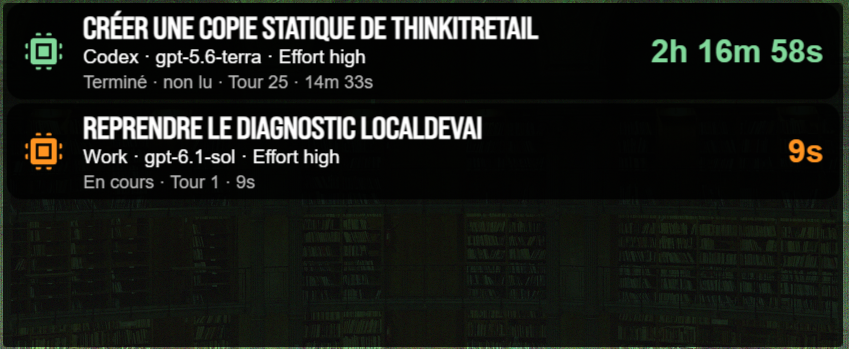

# AI Task List pour iCUE

AI Task List affiche les tâches en cours et les résultats non lus des assistants IA sur le CORSAIR XENEON EDGE. Codex, Work et ChatGPT sont pris en charge par l’adaptateur intégré lorsque leur état est visible dans l’application de bureau. D’autres clients peuvent publier leurs propres tâches selon le [format JSON documenté](docs/providers.md).



La ligne grise indique l’activité, le numéro du tour et sa durée. Le grand chrono reprend le temps de l’objectif lorsqu’il existe, ou le cumul de traitement de la dernière demande. Une tâche terminée reste visible jusqu’à ce que sa source cesse de la signaler comme non lue. La capture montre la version précédente.

## Installer sous Windows

Il faut iCUE 5.52 ou ultérieur et un XENEON EDGE. Pour suivre Codex, ouvrez l’application de bureau sous le même compte Windows. Le paquet contient le binaire officiel Node.js et les scripts du collecteur.

1. Extrayez l’archive Windows dans un dossier et vérifiez les signatures de l’installateur et du collecteur avec PowerShell.

   ```powershell
   Get-AuthenticodeSignature .\Install-AI-Task-Collector.ps1, .\app\node.exe
   ```

   Une distribution signée doit indiquer `Valid` pour les deux fichiers. Le binaire Node.js porte la signature de l’OpenJS Foundation. Les archives nommées `unsigned-preview` sont des builds de développement dont le script d’installation est non signé.

2. Dans PowerShell, exécutez `.\Install-AI-Task-Collector.ps1`. Le collecteur démarre pour le compte courant et se relance à l’ouverture de session. Ajoutez `-NoCodex` si vous voulez utiliser uniquement des fournisseurs externes.
3. Importez `AI-Task-List-2.0.0.icuewidget` dans iCUE. Autorisez l’accès à `<Home>/AI-Task-List/tasks.json` lorsque iCUE le demande, puis ajoutez **AI Task List** à votre écran.

Le widget se rafraîchit à la prochaine mise à jour du fichier. Si le collecteur est indisponible, vérifiez la date de modification de `%USERPROFILE%\AI-Task-List\tasks.json` et l’autorisation de fichier dans iCUE.

Pour désinstaller le collecteur, exécutez `.\Install-AI-Task-Collector.ps1 -Uninstall`. Les fichiers des fournisseurs sont conservés dans `sources`. Retirez ensuite le widget de l’écran iCUE. Le widget historique et son bridge peuvent rester actifs pendant un essai de cette version.

## Données et permissions

Le collecteur s’exécute avec les droits du compte Windows courant. L’adaptateur Codex ouvre le catalogue et les bases SQLite en lecture seule. La sortie contient les identifiants et titres des tâches, leurs états, leur provenance, le modèle, l’effort et les chronos disponibles. Le widget dispose d’une permission pour un fichier précis. Le collecteur et le widget fonctionnent sans port d’écoute, sans clé API et sans connexion réseau pour la collecte. Les titres du fichier sont lisibles par le compte Windows.

## Construire et signer

La construction nécessite le binaire Windows officiel de Node.js 26 ou ultérieur et le CLI Corsair `icuewidget` dans le PATH. Avec le CLI 0.5 ou ultérieur, la validation couvre aussi les permissions. Le build valide le widget, exécute les tests et place les fichiers dans `dist/`. Il joint la licence de la version de Node.js utilisée. Pour fournir cette licence depuis un fichier local, utilisez le paramètre `-NodeLicense`.

```powershell
.\build.ps1
.\build.ps1 -SigningThumbprint 'EMPREINTE_DU_CERTIFICAT'
```

La seconde commande nécessite un certificat de signature de code approuvé par Windows dans le magasin personnel de l’utilisateur et sa clé privée. Le build vérifie la signature officielle de Node.js, inscrit les SHA-256 du binaire et des scripts du collecteur dans l’installateur, puis signe et vérifie l’installateur. Une erreur de signature interrompt le build signé.

- [Plugin File System d’iCUE](https://docs.elgato.com/icue/widgets/references/plugins/file-system-provider/)
- [Créer un paquet iCUE](https://docs.elgato.com/icue/widgets/)
- [Signature Authenticode dans PowerShell](https://learn.microsoft.com/powershell/module/microsoft.powershell.security/set-authenticodesignature)
